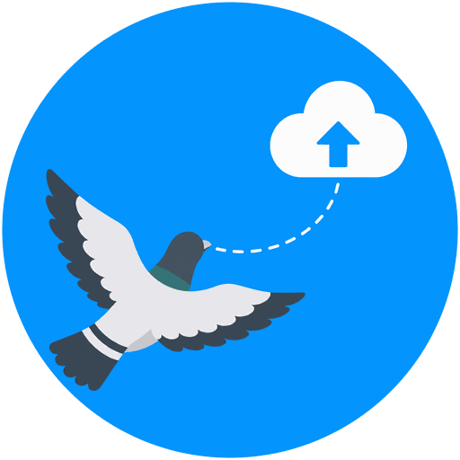
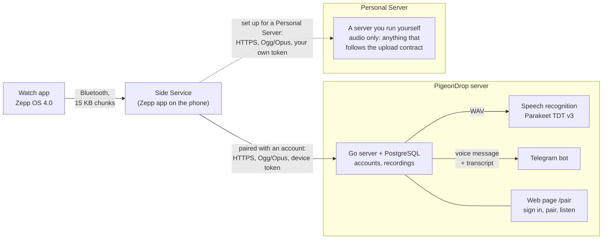

<p align="center"></p>

<h1 align="center">PigeonDrop</h1>

<p align="center"><strong>Voice notes from your wrist.</strong> Press a button on your Amazfit watch, speak, and get the audio and its transcript on a server you run yourself, in Telegram, or on a web page. Or skip all of that and have the watch send the audio straight to a server of your own.</p>

<p align="center">
  <a href="https://github.com/ArturSharafutdinov/PigeonDrop/actions/workflows/ci.yml"></a>
  <a href="LICENSE"></a>
  
  
  
</p>

<!-- DEMO: put the demo video or GIF here. If it is generated or edited, say so in its caption ("illustrative, not a screen recording"). -->

PigeonDrop is a complete voice-note pipeline, from a smartwatch app to a server to a chat bot, built end to end: a Zepp OS app that records on the watch and survives a flaky Bluetooth link, a Go server with accounts and a job queue, a speech recognition service, and a Telegram bot. It was built for one person's own use, and is published as a worked example of that kind of system and of the Zepp OS platform.

> **Status.** It runs in production for its author. Recording, upload, pairing, playback, transcription and Telegram delivery have been tried on a real watch, phone and Telegram. What has *not* been tried is listed under [Verified and not verified](#verified-and-not-verified). It is not an official Zepp or Amazfit product; see [THIRD_PARTY_NOTICES.md](THIRD_PARTY_NOTICES.md).

## How it works



The audio goes to **one** of the two, whichever the watch is set up for (**Settings → Connection** on the watch). The part inside the first box needs an account on a PigeonDrop server; the second needs nothing but a server of yours that accepts the upload.

1. A press of the watch's shortcut button records a voice note (up to 60 s). The file is kept in a queue on the watch until the server confirms it.
2. The watch sends it to the phone over Bluetooth in numbered 15 KB chunks, one at a time, each acknowledged; the phone's Side Service wraps the audio into a standard Ogg/Opus file (no re-encoding) and uploads it: with the watch's device token to the PigeonDrop server, or, if the watch is set up for a Personal Server, with the token you made for it to your own server.
3. The PigeonDrop server stores the recording under its owner's account, converts it for playback, and queues it for speech recognition and for Telegram.
4. The recognizer turns it into text, one recording at a time. The bot sends the voice message with its transcript to the linked chat.
5. On the web page you sign in, pair watches, listen, read transcripts and download everything.

### Where the audio goes

| | PigeonDrop server | Personal Server |
|---|---|---|
| What it is | the Go server in this repository (accounts by invitation) | any server of your own that follows the small upload contract |
| How the watch is set up | pair it with an account: **Pair via QR code** | give it an address and an access token: in the Zepp app, or on the pairing page's **Personal server** tab |
| What you get | the audio, transcripts, Telegram delivery, the web page | the audio only; what your server does with it is up to your server |
| Account needed | yes | no |

Recordings that have not been sent yet wait on the watch and go to whichever server it is set up for when they are sent; the watch never switches servers by itself. The steps, the contract a server must follow and what is protected are in [Personal Server](docs/personal-server.md).

## What is in it

- **Watch app** (`PigeonDrop/`): recording, a persistent upload queue, playback, pairing with a QR code, a choice of where the recordings go (the PigeonDrop server or a Personal Server of your own), and messages that say what is wrong ("the phone does not answer", "the server is unreachable", "storage is almost full") instead of failing silently. English and Russian interface.
- **Go server** (`backend/`): invitation-only accounts, cookie sessions, watch pairing and revocable device tokens, per-account storage limits, an OpenAPI-first `/v1` API, and a small web page.
- **Speech recognition service** (`stt/`): NVIDIA Parakeet TDT 0.6B v3 (int8) behind a token-protected HTTP API, in its own container with a 3 GB limit.
- **Personal Server mode** (`docs/personal-server.md`): the watch can send the audio, and only the audio, to a server you run yourself, with no account on a PigeonDrop server. The address and the access token reach the watch either from a form in the Zepp app, or from the pairing page, encrypted in the browser so that the PigeonDrop server only relays something it cannot read.
- **Telegram bot**: long polling (no public address needed), links a chat to an account, sends each recording with its transcript, "Seen" button deletes it from the chat.
- **Operations** (`tools/backup`, `.github/`): database dump and restore check, CI, and deployment with Coolify.

## Supported watches

| Watch | Status |
|---|---|
| Amazfit Active 2 (Round) | Supported. The app is developed and tried on this watch (a round 466×466 display). |
| Amazfit Active 2 NFC (Round) | Expected to work, not tried. Zepp's device list gives it the same display and API level, and the app does not use the NFC chip. It has its own device identifiers, so choose it as the target when installing with `zeus preview`. |

Nothing else has been tried. The package targets round screens with a design width of 480 (`platforms` in [`app.json`](PigeonDrop/app.json)) and needs Zepp OS API level 4.0 or newer. The layout is made for a round display, so another round watch with Zepp OS 4.0 may accept it, but square screens (such as the Amazfit Active 2 Square) are not supported. If you try another watch, an issue with what happened is welcome.

## Engineering notes

The parts I would point a reviewer at:

- **Delivery over an unreliable link.** The queue lives on the watch (the phone's Side Service has no reliable storage). Chunks are acknowledged one by one, the recording is marked sent only when the server's answer arrives, and a repeated upload of the same recording is harmless. A single oversized `call()` once overran the Bluetooth send queue and failed silently; the design comes from that.
- **A format that is not a standard.** Zepp's recorder writes its own framing around Opus packets. The phone repackages them into Ogg/Opus without re-encoding, checked against an independent reader written from the RFCs and against `ffmpeg`'s strict decoder.
- **Handing a secret to a watch through someone else's server.** On the pairing page's *Personal server* tab the address and token are encrypted in the browser with a key that only the watch has: the watch makes it for each attempt and puts it in the QR code after the `#`, which a browser never sends anywhere. The server relays the envelope from memory only (never the database, logs or backups), once, and cannot read it; the watch checks the tag before it decrypts anything. The page and the watch are tested against the same test vector, and the watch tests its own cryptography before it shows the QR code, because nothing about it could be tried on a real watch from here. What this cannot protect against, a tampered page, is stated on the page.
- **Device pairing** follows RFC 8628 (device authorization grant): the watch shows a short code and a QR code, the person approves on the phone, and the watch receives a token that can be revoked.
- **Job queues in PostgreSQL** (transcription and Telegram delivery) with leases, `SKIP LOCKED`, attempt fencing and workers that restart after a panic, instead of a message broker for a load that does not need one.
- **Contract first.** The `/v1` API is described in `backend/api/openapi.yaml`; Go types and handlers' interfaces come from `oapi-codegen`, queries from `sqlc`, and CI fails if generated code is stale.
- **Measured, not guessed.** The speech model was chosen after benchmarking four models on real recordings for accuracy, CPU time and memory under production-like limits.
- **Honest about the platform.** [`gotchas.md`](.claude/skills/zeppos/references/gotchas.md) records where Zepp OS differs from its documentation (one live `Player`, every page being its own bundle, closing file descriptors, and more), with how each was found.

## Quick start

You need Go 1.26, PostgreSQL server binaries, Node.js 22+ and the [Zepp OS CLI](https://docs.zepp.com/docs/guides/tools/cli/) (`npm install -g @zeppos/zeus-cli`). Docker is only needed for the speech service.

```bash
git clone https://github.com/ArturSharafutdinov/PigeonDrop.git
cd PigeonDrop/backend

scripts/dev-db.sh up                                   # a throwaway PostgreSQL on 127.0.0.1:55432
make run                                               # the server on http://localhost:3000
DATABASE_URL="$(scripts/dev-db.sh url)" ./bin/pigeondrop invite create   # an invitation code to register with
```

Open <http://localhost:3000/pair>, register with the invitation code and sign in.

**Speech recognition** (optional, about 640 MB model in the image):

```bash
docker build -f stt/Dockerfile -t pigeondrop-stt stt
docker run --rm -p 8000:8000 -e STT_TOKEN="$(openssl rand -hex 32)" --memory=3g --memory-swap=3g pigeondrop-stt
# then start the server with STT_URL=http://localhost:8000 and the same STT_TOKEN
```

**Telegram** (optional): create a bot with @BotFather and start the server with `TELEGRAM_BOT_TOKEN`; the web page then offers to link a chat.

**Watch app:**

```bash
cd PigeonDrop
cp config.example.js config.js        # set SERVER_URL to your server's public address
zeus dev                              # the simulator; `zeus preview` makes a QR code for a real watch
```

The phone reaches your server over the internet, so for a real watch the server needs a public HTTPS address. Deployment is described in [docs/deployment.md](docs/deployment.md).

**Send the audio to your own server instead** (optional, no PigeonDrop account): on the watch open **Settings → Connection → Personal Server** after entering the address and token in the Zepp app, or scan the pairing QR code and use the **Personal server** tab of the page it opens. A server only has to accept `POST /v1/messages` with a bearer token; the contract is in [Personal Server](docs/personal-server.md).

## Tests and quality

| What | How |
|---|---|
| Backend | `cd backend && make check` (gofmt, vet, tests with the race detector against a real PostgreSQL, generated code up to date), `make lint`, `make vuln`; the pairing page's script is tried with Node by the same `go test` |
| Watch app | `cd PigeonDrop && npm test` (the real source on stubs of the Zepp OS modules; more than 800 checks) |
| Speech service | `cd stt && python3 -m unittest discover -s tests -t .` (fake model); `stt/smoke-synthetic.sh` tries the real image |
| CI | every pull request runs the checks of the parts it touches, plus golangci-lint, govulncheck, `npm audit`, shellcheck and gitleaks; a push to `main` deploys |

## Verified and not verified

**Tried on real hardware** (an Amazfit Active 2 (Round), an iPhone, a production server, the real Telegram): recording, queued upload over Bluetooth, pairing by QR code, playback, transcription, and delivery to Telegram.

**Not tried, or not measured:**
- The English interface and the new language handling on a watch (the Russian texts are unchanged; the English lines are fitted by rule, not by eye).
- The storage warning page and its vibration on the round display.
- Personal Server on real devices: the form in the Zepp app, the hand-over through the pairing page (including the watch's cryptography, whether the QR code with the extra key scans from the round display, and whether phone scanners keep the part after the `#`), and the new screens. The page was tried in a browser against a server on a computer, and the encrypted result was opened with a separate implementation of the watch's side; nothing was tried on a watch.
- Android: the phone side was developed against an iPhone.
- The time and memory of repackaging a 60 s recording on a phone (a 2 s one was measured).
- The timeouts of the "no connection" messages are estimates, not measurements of a real Bluetooth link.
- The automated tests run on stubs, so they do not replace a run on the device.

## Troubleshooting

The problems that cost the most time so far, with what fixed them, are in [docs/troubleshooting.md](docs/troubleshooting.md). Two are worth knowing before you start:

- **The watch says the phone is not reachable although Bluetooth works.** The Zepp app on the phone can keep running an old cached copy of the app's Side Service, and installing a new preview does not replace it. The page shows how to check this in the Zepp app's log screen; a full reinstall of the Zepp app fixed it.
- **Every deployment fails within seconds.** The registry token on the server has probably expired.

## Privacy

Recordings and transcripts are personal. They are stored on the server you run and are not sent to any cloud service; the speech model runs in your own container. The one exception is a Telegram chat you link yourself: its voice message and transcript pass through Telegram's servers. With a Personal Server the recordings go from your phone straight to the server you named and do not touch a PigeonDrop server at all; the address and token of that server stay on your phone and watch if you enter them in the Zepp app, or pass encrypted through the PigeonDrop server (in memory only, for at most 10 minutes) if you use the pairing page. See [SECURITY.md](SECURITY.md) for how accounts, tokens and the web page are protected.

## Repository layout

```
PigeonDrop/   Zepp OS app: pages, upload queue, Side Service (app-side/), language tables (i18n/), tests
backend/      Go server: API (api/openapi.yaml), handlers, queues, Telegram bot, migrations, Dockerfile
stt/          speech recognition service (Python) and its Dockerfile
docs/         architecture, API, deployment, CI/CD, troubleshooting, decision records, research notes
tools/        backup and restore check for the production data
.github/      CI workflow and its helper scripts, issue and pull request templates
.claude/      configuration of the AI assistant this project is built with (see .claude/README.md)
```

## Documentation

- [Architecture](docs/architecture.md): the data flow, one module at a time, and why it is built this way
- [HTTP API](docs/api.md) and [`openapi.yaml`](backend/api/openapi.yaml)
- [Personal Server](docs/personal-server.md): sending the recordings to a server of your own, and what such a server must do
- [Deployment](docs/deployment.md) and [CI/CD](docs/ci-cd.md)
- [Decision records](docs/adr/): the choices behind the design (stack, queues, formats, pairing)
- [Research](docs/research/): the speech model comparison and its benchmark harness
- [Contributing](CONTRIBUTING.md), [Security](SECURITY.md), [Changelog](CHANGELOG.md)

## Acknowledgements

NVIDIA's [Parakeet TDT 0.6B v3](https://huggingface.co/nvidia/parakeet-tdt-0.6b-v3) (CC BY 4.0) and Ilya Stupakov's ONNX conversion and [`onnx-asr`](https://github.com/istupakov/onnx-asr); Zepp Health's open sample apps, whose messaging library is vendored under `PigeonDrop/shared/` (Apache-2.0); Tomi Hakala's pure-Go Opus decoder [`go-opus`](https://github.com/tphakala/go-opus). Full list: [THIRD_PARTY_NOTICES.md](THIRD_PARTY_NOTICES.md).

## License

[MIT](LICENSE) © 2026 Artur Sharafutdinov. The license covers the code and documents written for PigeonDrop; third-party components keep their own licenses, see [THIRD_PARTY_NOTICES.md](THIRD_PARTY_NOTICES.md). Amazfit, Zepp and Zepp OS are trademarks of their owners; this project is not affiliated with them.
