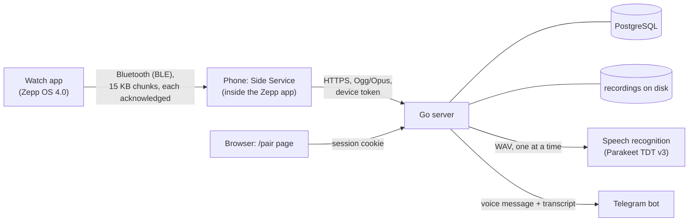
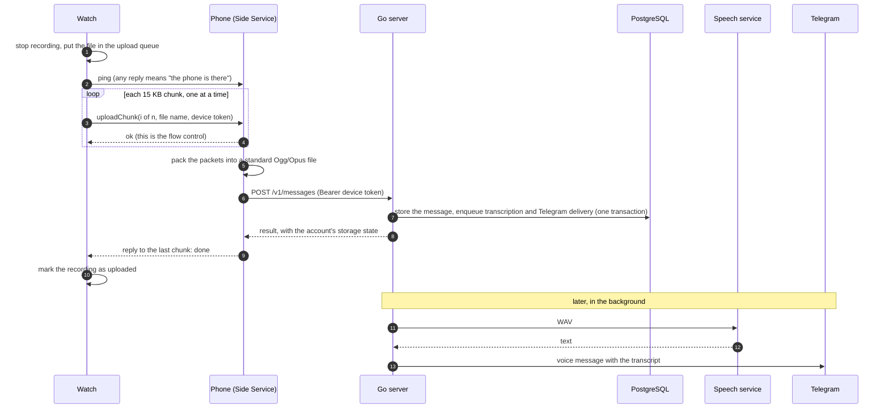
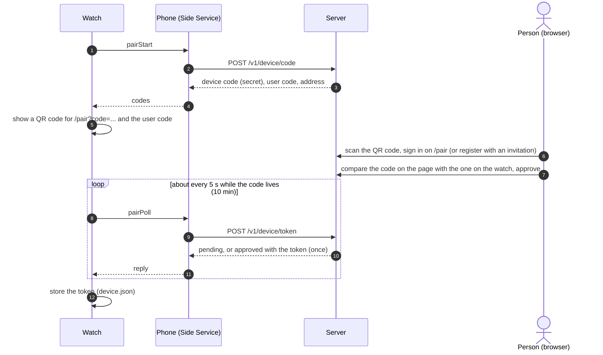
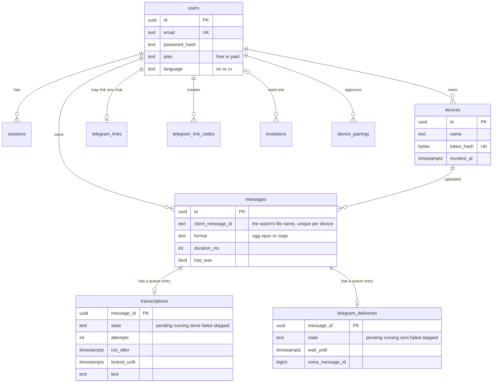
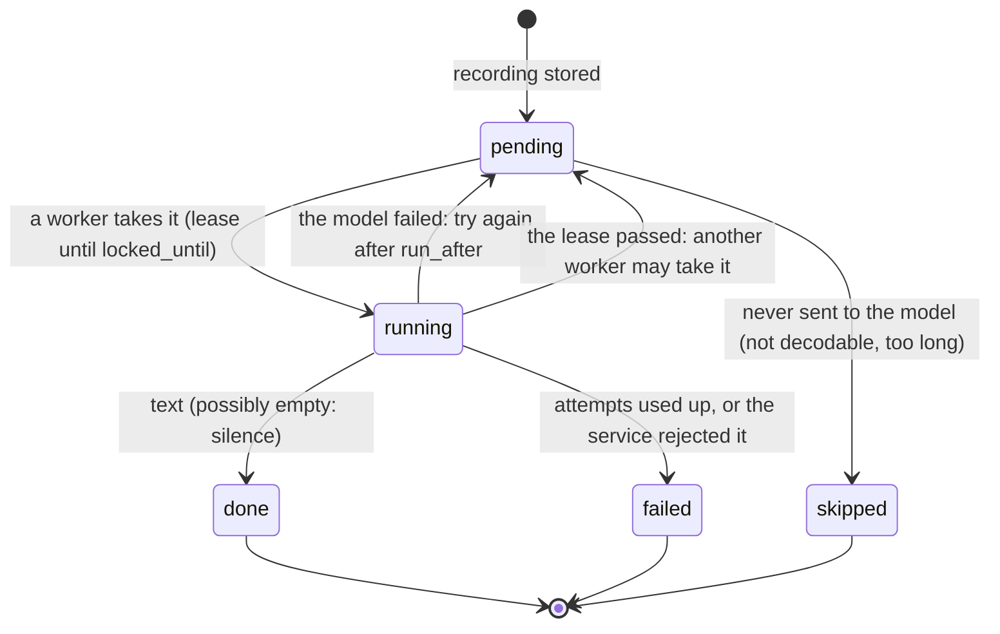

# Architecture

How PigeonDrop is put together, and why. The README gives the overview; this document is for someone who wants to change the code and needs the reasons behind it. Where a statement rests on a measurement or on an observation on a real watch, it says so; where it does not, it says that too.

The target device is a round watch running Zepp OS 4.0 or newer; the manifest declares a design width of 480 (developed on an Amazfit Active 2 (Round), whose display is 466×466; the NFC variant is expected to work, see the README). Decisions are recorded one by one in [`docs/adr/`](adr/); the HTTP contract is in [`api.md`](api.md) and `backend/api/openapi.yaml`.

## 1. The three nodes and the path of one recording

1. **Record.** The hardware shortcut button starts and stops a recording (`page/index.js`); a long press plays the last one. The file is kept on the watch as `voice_messages/voice_<time>.opus`.
2. **Queue.** The recording joins a persistent queue on the watch (`utils/uploadQueue.js`, section 3). It stays there until the server confirms it.
3. **Send over Bluetooth.** The watch sends it to the phone through the vendored `MessageBuilder` channel in numbered chunks of 15 KB, **one `request()` at a time, waiting for the reply to each** (section 6 explains why). Every chunk carries the watch's device token.
4. **Relay.** The phone's Side Service (`app-side/`) collects the chunks in memory. When the last one arrives it wraps the recording into a standard Ogg/Opus file (`utils/oggOpus.js`, packets are not re-encoded) and `fetch()`es it to `SERVER_URL/v1/messages` with `Authorization: Bearer <device token>`. The phone keeps no token and no state of its own. (A watch the person has set up for a server of their own puts that server's `serverUrl` in every chunk, and the phone posts there instead; see "A server of the person's own" below.)
5. **Store.** The server finds the device by the token's hash, stores the file under the message id for the device's owner, and answers. A repeated upload of the same file name from the same device returns the original result and creates nothing. There are three limits: a recording is at most 512 KiB (a minute of audio is about 140 KiB), a device may upload at most 60 recordings an hour, and an account holds at most 100 MiB; when a new recording does not fit, the oldest ones are deleted and the new one is accepted, and the answer says so.
6. **Confirm.** The phone returns the server's answer as the reply to the *last chunk*. Only that reply marks the recording as uploaded in the watch's queue, and it carries the account's storage state (section 5).
7. **Process.** In the same database transaction that stores the message, the server enqueues a transcription and, if the account has a linked Telegram chat, a Telegram delivery (section 8). Workers inside the server process pick them up.

## 2. Pairing a watch with an account

A watch proves whose it is with a **device token**. Pairing follows RFC 8628 (the OAuth 2.0 device authorization grant): a device without a keyboard shows a code, and a person approves it on a second device.

- The watch screen is held on while it waits, for at most the life of the code.
- If a person revokes the device on the web page, the next upload gets `401`; the watch forgets the token and says "Pairing was revoked". Recordings are not deleted: they are sent after the next pairing.
- A watch without a token sends nothing. Recordings wait in the queue and the screen says "Watch is not paired".
- The same server address (`SERVER_URL` in `config.js`) is used for pairing and for uploads.

### A server of the person's own

A person who does not want their recordings on the PigeonDrop server can set the watch up for a server they run themselves (a "Personal Server"). It only receives recordings: speech recognition and Telegram belong to the PigeonDrop service. The watch then keeps that server's address (`serverUrl`) and the token that server gave in the same `device.json`, written together, and puts the address in every `uploadChunk` and in the connection check; the Side Service uses it instead of `SERVER_URL` (`resolveServer` in `utils/serverUrl.js`). Rules that hold whatever else changes:

- Only plain `https://` addresses are taken, with no login, query or fragment (`normalizeServerUrl`).
- **The watch never goes back to the PigeonDrop server on its own.** An address the phone cannot use is an error and the recordings stay on the watch; a token the own server refuses is dropped but the address stays (`dropCustomToken`); a damaged record sends nothing. Where the recordings go changes only when the person changes it.
- Pairing (`pairStart`, `pairPoll`) is always with the PigeonDrop server.
- Recordings that have not been sent stay queued and go to whichever server the watch is set up for when they are sent.

The person sets it up in two steps: the address and the token go into the Settings App in the Zepp app (`setting/index.js`, stored in the Zepp app's `settingsStorage`), then **Settings → Connection → Personal Server** on the watch asks the phone for them (`getServerConfig`, answered by `app-side/serverConfig.js`), shows the host and the number of waiting recordings (`page/server.js`) and saves them only after the person confirms. The watch asks and the phone answers, as everywhere else in the app; the phone never pushes. What such a server must implement is in [Personal Server](personal-server.md).

#### Handing the settings over through the pairing page

The server side of a second way to enter the same two values: the pairing page's browser encrypts them with a key that only the watch has and posts the result to `POST /v1/device/relay` (`backend/internal/httpapi/relay.go`); the watch collects it with its next `POST /v1/device/token` poll, which then answers `relayed` with the envelope. The server cannot read the envelope and is built to keep as little of it as possible:

- It lives in a map in the process's memory (`relayStore`), keyed by the id of the pairing row, and nowhere else: not in PostgreSQL (the pairing row is untouched while it waits, and is deleted when it is delivered), not in a log (the type prints as `redacted` in every `fmt` verb and in `slog`), not in a backup. A timer removes it when the pairing's time is up, even if nobody asks.
- It is delivered once: the poll deletes the pairing row first (`DeletePairing`, whose row count is the exactly-once gate, as `RedeemPairing` is for a token) and only then takes the envelope out of memory. Closing the pairing means the same code cannot be approved afterwards.
- The server checks the shape (version, encoding, sizes) and nothing else; it has no key to check the tag with. An envelope that was waiting when someone approved the same code wins: it can only have been made by someone who held the watch's QR code, while an approval needs only the short code.
- The store is bounded (1000 envelopes) and wrong codes are limited per address (`DeviceRelayIP`), so a flood neither fills the memory nor guesses codes.
- With two containers alive during a deployment a request may land in one and the poll in the other; the pairing then runs out and the person starts again.

## 3. The upload queue lives on the watch

If the watch is out of Bluetooth range, or the phone has no internet, a recording must not be lost. The queue that guarantees it is on the **watch**, not on the phone, because the phone side cannot be trusted with state: `MessageBuilder` gives no delivery guarantees (a `call()` can fail without a trace when Bluetooth drops, and there is no retry or resend on reconnect), and the Side Service has no documented, stable lifecycle and no timer wake-up (it is purely reactive). The one persistent store that was confirmed there is `settingsStorage`, a small key-value store; the watch has `@zos/fs`. So the Side Service stays a thin stateless relay: receive, try `fetch()`, report back, keep nothing.

- `utils/uploadQueue.js` keeps in `uploads.json` the names of recordings the server has confirmed. Everything else on the watch is pending.
- Two separate caps (`config.js`): `MAX_RECORDINGS` (20) applies only to already-uploaded recordings, `MAX_PENDING_RECORDINGS` (50) is a higher ceiling for the ones that have not reached the server. A recording is never deleted just for being old while it waits, only when the second cap is exceeded.
- **Three triggers start a sweep:** a new recording, Bluetooth reconnecting (`@zos/ble.addListener` in `app.js`) and opening the app. There is deliberately no periodic timer.
- A sweep is strictly sequential: one recording at a time, one chunk at a time. It stops at the first failure of the phone or the server, because hammering an unreachable server with the rest of the queue only wastes battery. A recording that is still being written is never part of a sweep.
- A recording that cannot be read (the file will not open, `statSync` fails, a short read) is a problem of that one file: it is skipped, the others are sent, and the error is reported at the end. It stays queued; "Clear memory" is how to get rid of it. A failed `statSync` is never treated as an empty file (that would delete the recording).
- Every chunk is retried twice before the recording is given up on. Chunk size is a multiple of 3 bytes, so the base64 of the chunks concatenates into the base64 of the whole file with no padding in the middle.
- **Duplicates are harmless.** The confirmation travels back over the same unreliable link; if it is lost after the recording reached the server, the watch will send it again. `POST /v1/messages` is therefore idempotent by `messageId` within a device (the file name on the watch), which is part of the API contract.
- **State shared between pages.** `app.js` and every page are compiled into separate bundles, each with its own copy of every module, so a module variable is not shared. The queue's live state (the recording being written, whether a sweep is running, the listener) lives in `getApp()._options.globalData.uploads`; "a sweep is running" is a lease that expires, so a sweep whose page was torn down cannot block uploads for the rest of the session.

### Two kinds of "no answer"

A missing reply looks the same from the watch whether the Zepp app on the phone is stuck or the phone has no internet, but the cures differ, so the screen tells them apart (`utils/linkProblem.js`):

- Before each sweep the watch pings the phone (10 s, one retry). Any reply, even an error, means the phone is there. Silence ends the sweep with *"Phone is not reachable. Restart the Zepp app"* after about 20 s.
- If the phone is there but cannot reach the server (no internet, no answer in time, a 502/503/504 from the proxy), it answers `noServer: true` itself, and the screen says *"Server is unreachable. Check the internet on the phone"*.
- This works only because the phone gives its own calls a deadline (30 s for an upload, 10 s for pairing) that is always shorter than the watch's wait (60 s for the last chunk, 15 s for pairing, 30 s for other chunks). Keep that order when changing either. Without the deadline a hung request could not be told from a dead Side Service, and the watch sat for three minutes on "Sending" with no reason.
- Settings has a "Check connection" button: the phone calls `GET /healthz`, then an empty `POST /v1/messages` with the token (400 means accepted, nothing stored), and the status line says in a few words which step broke.

## 4. Pages and modules

### Watch (`PigeonDrop/`)

| File | Role |
|---|---|
| `app.json`, `app.js` | Manifest (microphone permission, round target with design width 480, pages) and the app entry: one BLE connection (`MessageBuilder`) for the life of the app, plus the reconnect trigger. |
| `page/index.js` | Main screen. Click: start/stop. Long press: play the last recording. While recording it shows a stopwatch and a **Cancel** button in place of the two navigation buttons (a third button does not fit the round screen); Cancel stops and deletes the file at once, and the file stays "being written" for the queue until it is gone. |
| `page/list.js`, `page/settings.js`, `page/storage.js`, `page/pair.js` | Recordings list, settings (connection, check connection, clear memory with a two-step confirmation), the storage warning, and pairing with the QR code. |
| `page/connection.js`, `page/server.js` | Where the recordings go: the menu (pair via QR code, take a Personal Server from the phone, go back to PigeonDrop) and the confirmation that shows the host and the number of waiting recordings before anything is saved. The menu leaves by `replace`, so the page the person comes back to is built afresh. |
| `setting/` | The Settings App: the form in the Zepp app for the address and token of a Personal Server (`index.js`, built from the Zepp app's own widgets; `problems.js`, the checks of what was typed, tested outside the app). English only. |
| `utils/uploadQueue.js` | The queue (section 3). |
| `utils/recordings.js`, `utils/device.js`, `utils/storageState.js` | File naming and listing; the device token and, for a watch set up for a server of the person's own, that server's address; the last storage state the server reported. Corrupt files mean "not paired" / "no warning", never a crash. |
| `utils/serverUrl.js` | Which addresses of a person's own server are taken (`https://host[:port][/path]` only) and which server a message from the watch is for. Shared by the watch, the Side Service and the Settings App; the cases are in `PigeonDrop/test/fixtures/server-url-cases.json`. |
| `utils/player.js`, `utils/screen.js`, `utils/linkProblem.js` | The one shared `Player`; holding the screen on for a bounded time; the texts for the two kinds of lost link. |
| `i18n/` | English and Russian tables, `t(key, values)`. |
| `config.js` | Local, not committed (`config.example.js` is the template): `SERVER_URL` and the limits. |

### Phone (`PigeonDrop/app-side/`)

The Side Service has no screen. `index.js` dispatches requests from the watch by `type` (`uploadChunk`, `pairStart`, `pairPoll`, `checkServer`, `getServerConfig`, `ping`); `uploads.js` collects chunks in memory (an incomplete upload lives at most 10 minutes; if the Side Service restarts mid-upload the watch starts that recording again) and sends the finished file; `pairing.js` and `serverCheck.js` are the phone's halves of pairing and of the connection check; `serverConfig.js` reads what the person entered in the Settings App; `base64.js` converts with `Buffer` if the phone's runtime has it and plain JavaScript if not. A failure is always returned to the watch as `{ ok: false, ... }`, never thrown.

### Vendored library (`PigeonDrop/shared/`)

`MessageBuilder`, copied (it is not an npm package) from Zepp's official sample apps under Apache-2.0. It cuts large payloads into BLE-sized packets and reassembles them. Treat it as third-party code; the two changes made to it are listed in the file headers and in [`THIRD_PARTY_NOTICES.md`](../THIRD_PARTY_NOTICES.md).

### Server (`backend/`)

| Package | Role |
|---|---|
| `internal/httpapi` | Handlers for `/v1/*` (sign-in, pairing, recordings, transcripts, Telegram), the `/pair` page (hand-written, strict CSP) and `/healthz`. |
| `internal/auth` | Argon2id hashing, token and code generation (everything secret is stored as a SHA-256 hash). |
| `internal/audio` | Reads standard Ogg/Opus (checks page checksums, bounds and the number of channels) and the old raw Zepp format (told apart by the first bytes), writes `.wav`. |
| `internal/storage`, `internal/db`, `migrations/` | Recordings on disk (`STORAGE_DIR`) and PostgreSQL (goose migrations, sqlc queries). |
| `internal/transcribe` | The transcription queue and its worker; calls the speech service. |
| `internal/telegram` | The bot (long polling), account linking by a one-time link, and the delivery queue and worker. |
| `internal/supervise` | Restarts a background loop with a pause when it panics. |
| `cmd/pigeondrop` | `serve` plus operator commands (`invite`, `user`, `stt`, `telegram`, `healthcheck`, `version`). |

### Speech service (`stt/`)

A small Python HTTP service in its own container: `POST /v1/transcribe` takes a WAV and returns text, behind a bearer token, one recording at a time (a second concurrent one gets `429`). Parakeet TDT 0.6B v3 (int8) is baked into the image at a pinned revision.

## 5. Account storage and the warning on the watch

A silent deletion of the oldest recordings would be a nasty surprise, but the server cannot write to the watch: the app has no push channel and the Side Service is not always alive. So the storage state rides **in the answer to every upload** (`storage.state`: `ok`; `nearly_full` from 90%; `full` when this upload pushed old recordings out). The Side Service hands it to the watch in the reply to the last chunk, the queue remembers it (`storage.json`) and decides whether it is *news*: "nearly full" is news once (on the change from ok), "full" is news every time, because something was deleted each time. If there is news, the sweep's last event carries an `alert`; a queue of several recordings produces one alert, the strongest.

The main screen opens `page/storage.js` for an alert: one long buzz, the screen held on, a title and an explanation for ten seconds, then back by itself. It is a page of its own because a label on the main screen shared the space with the status text and the buttons and was drawn over them (seen on the real watch). It does not open at app start, and an alert that arrives while recording waits until the recording ends. A revoked token clears the remembered state, because it was about the previous account.

Two other answers to an upload matter: `413` (recording too large: skipped like an unreadable file, since sending it again changes nothing) and `429` (too many uploads from this device: the sweep stops and the recordings wait for the next trigger).

## 6. Decisions and gotchas worth knowing before changing something

**One channel, not two.** An official `TransferFile` path ran in parallel with `MessageBuilder` for a while. Its phone-side file object exposes only the name, path and size, with no way to read the bytes, so it never did anything but fill the phone's storage. It was removed. `MessageBuilder` is the only channel that carries readable data.

**Never send a recording as one message.** A 60 s recording is about 160 KB, 212 KB as base64. Sent as one `call()` it became about 60 BLE packets queued in a single synchronous loop with no backpressure; the send queue overran, `ble.send` returned `false`, and the resulting exception was lost in a promise nobody handled, so the upload failed silently. The debug flag of the vendored library made it worse (a hex dump of every packet, megabytes of strings only for the log). Hence the chunks, the acknowledgement of each, and `DEBUG = false`.

**Zepp's recording is not standard Ogg/Opus.** The recorder writes `[8-byte header][Opus packet]` back to back; the first four header bytes are the payload length, big-endian (the other four are not understood and are ignored). Zepp's own guide describes a 12-byte prefix, which does not parse on real recordings. The payloads are SILK wideband, mono, 20 ms per packet. The phone wraps them, unchanged, into an Ogg/Opus file (RFC 3533 and 7845, 50 packets per page), because other recipients (a self-hosted server, Telegram's voice messages) want a standard file and the packets are already valid Opus; the result is read back by an independent reference reader in the tests and decoded by `ffmpeg` in strict mode. A recording cut off mid-packet is trimmed to its whole packets. The time and memory of this packing on a real phone for a 60 s recording are **not measured** (a 2 s one was).

**The screen sleeping kills the app.** Zepp OS puts the screen to sleep and about 10 s later closes the Mini Program, which ends a recording without ever queuing it. Three things can sleep the screen (the page timeout, lowering the wrist, a palm on it), so while recording all three are suspended (`@zos/display`), for a bounded time. The same hold covers uploading: it is re-armed by the first chunk of any sweep and renewed while chunks keep going, ends early when the queue empties, and stays through an error so the reason can be read. A hold always has a limit, so a forgotten recording cannot drain the battery.

**Only one `Player`, and pages cannot share a module variable.** The hardware allows one live `Player`; a second one throws. Because every page is its own bundle, the one `Player` is kept in the app's global data (`utils/player.js`) and shared by the main page and the list.

**Close file descriptors as `closeSync({ fd })`.** The bare-number form leaves the descriptor open and the watch has only a few, so after several uploads `openSync` fails.

**Round display.** Rectangles near the top or bottom edge are clipped by the bezel. Layout keeps every corner inside a radius of about 230 px.

**`QRCODE` needs its `bg_*` properties.** Without `bg_x/bg_y/bg_w/bg_h` the background is drawn far larger than the code and bleeds past the bezel; only a real device shows it.

**You cannot see Side Service logs.** The Zepp app's log screen shows the watch's logs, not the phone's. The phone therefore reports everything as a reply to the watch, which is the only way to observe it.

**The microphone permission** (`device:os.mic`) is documented nowhere; it was found by the runtime error `Permission Denied device:os.mic`.

More of these, each with how it was found, are in [`.claude/skills/zeppos/references/gotchas.md`](../.claude/skills/zeppos/references/gotchas.md).

## 7. Data model

Everything secret (session tokens, device tokens, invitation codes, device codes, Telegram link codes) is stored as a SHA-256 hash. A recording's row, its transcription entry and its delivery entry go together: deleting a recording, or the storage limit pushing it out, removes all three.

## 8. Background queues

Transcription and Telegram delivery are queues in PostgreSQL, not a message broker: one row per recording, created in the **same transaction** that stores the message, so a recording cannot be accepted without its place in the queue and one that was sent is never sent twice by a restart. Workers take rows with `FOR UPDATE SKIP LOCKED` under a lease (`locked_until`); if a worker dies the lease passes and another takes the row; the attempt that finishes a row is fenced by its attempt number so that a late worker cannot overwrite a newer one.

- **Transcription** sends the WAV to the speech service one recording at a time. A service that cannot be reached does not count as an attempt (it is given back); a recording that failed after the model had it does, up to a limit. The text shows on the web page, in `GET /v1/messages` and in the archive; the watch does not see it. If a recording fails, the page offers *Retry* (`POST /v1/messages/{id}/transcribe`).
- **Telegram delivery** has the same states plus a wait: it holds a recording back for up to `TELEGRAM_WAIT` so that the voice message goes out with its transcript under it, and sends it without the text if the text does not come in time. The *Seen* button under a recording deletes it from the chat (Telegram does not let a bot delete messages older than 48 hours).
- The workers run under `internal/supervise`: a panic is logged with its stack and the loop restarts after a pause that doubles up to a minute.

## 9. What is verified and what is not

**Tried on a real watch, phone, server and Telegram:** recording, queued chunked upload, pairing by QR code, playback, transcription and delivery.

**Not verified on hardware:**

1. The queue's assumptions about `@zos/ble.addListener` (whether it fires at once with the current status; whether registering once for the life of the app is safe) and whether the 300 ms pause between recordings is right.
2. The storage warning page on the round display (font size, clipping at the edge, the vibration) and the English and Russian texts' fit.
3. The limits 20 and 50: they are estimates; the real size of a recording and the watch's storage quota were not measured.
4. The packing on the phone for a 60 s recording (speed, memory), Android, and how Telegram renders such a file (as a voice message with a waveform, or as a plain file) on every client.
5. The timeouts of the "no connection" messages (10 s ping, 30 s chunk, 60 s last chunk, 30 s server wait) are estimates, not measurements of a real Bluetooth link; how the Side Service behaves when the system "freezes" the Zepp app is not known.
6. That module variables really are separate per bundle at run time: this was concluded from the build output (the same module's code is inside `app.bin`, `page/index.bin` and `page/pair.bin`) and the documentation, not by running it.

The automated tests run on stubs of the Zepp OS modules, so they do not replace a run on the device.

**Known limitations, left on purpose:** the transcription of a recording cannot be seen on the watch; recordings are stored as files on a volume next to the database; one language model serves all languages.

**Ideas, not planned:** names or tags for recordings; real multi-tenant hosting; a periodic retry through `@zos/alarm` (deferred on purpose: the three event triggers are considered enough); a "bring your own server" mode as an account setting.
