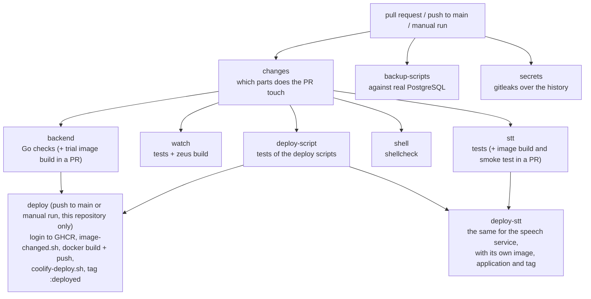

# CI/CD

What the pipeline runs, when, and why it is built this way. It is written so that it can serve as the starting point for moving another app's build into GitHub Actions. The step-by-step setup of the server (VPS, Coolify, PostgreSQL, secrets) is in [`deployment.md`](deployment.md), not here.

The source of truth is `.github/workflows/ci.yml` and the scripts in `.github/scripts/`. If this file disagrees with them, believe them.

## The picture

Two images are deployed: the Go server from `backend/` and the speech recognition service from `stt/`, each to its own Coolify application, independently. The watch app is not deployed like this: it is published through Zepp. It is built and tested, but the build goes nowhere.

The images are built in GitHub Actions and pushed to GHCR (`ghcr.io/<owner>/pigeondrop-backend` and `…/pigeondrop-stt`). Coolify on the VPS builds nothing: it only pulls `:latest` and restarts the container, so the build does not compete for resources with other projects on a shared VPS.

## When what runs

| Event | Checks | Deployment |
|---|---|---|
| Pull request | only for the parts it touches (below) | no |
| Push to a branch without a PR | nothing (only `main` is listed under `push`) | no |
| Push to `main` | all | yes, if the checks passed and `backend/` or `stt/` differs from what is deployed |
| Manual run ("Run workflow") | all | yes, always, both images |

## Spending few Actions minutes

- **Heavy checks only in a PR.** A push to a branch starts nothing by itself: checks run when the branch has a PR. After the merge into `main` they run again, because they gate the deployment.
- **Only what was touched.** The `changes` job looks at the files a PR changes (`git diff HEAD^1 HEAD` on the PR's merge commit; two commits of history are enough). Then:

  | Part | Files | What runs |
  |---|---|---|
  | `backend` | `backend/**` | `backend` |
  | `watch` | `PigeonDrop/**` | `watch` |
  | `scripts` | `.github/scripts/**` | `deploy-script` |
  | `stt` | `stt/**` | in the `stt` job the image build and smoke test are added (the tests on the standard library always run: they take seconds) |
  | `shell` | any `*.sh` | `shell` |

  A change to `ci.yml` itself touches every part. A documentation-only PR runs the short `changes` job and nothing else. A job skipped by its condition counts as passed for branch protection. Anything that is not a PR (a push to `main`, a manual run) runs everything, and so does a case where the changes cannot be worked out.
- **Cancelling stale runs.** The group `ci-${{ github.ref }}`: a new push to a PR cancels that PR's previous run. Runs of `main` are not cancelled: a deployment cancelled half-way would be lost (see `image-changed.sh`).
- **Dependency caches.** Go modules and build cache (`setup-go`) keyed by `backend/go.sum` and `backend/tools/go.sum` (`tools/` has its own modules for the code generators, which are slow to compile from scratch); the npm downloads of `zeus-cli` (`actions/cache`, keyed by the CLI's version). There is no Docker layer cache: the build layer depends on `VERSION` (the commit), so it would be rebuilt almost always, and the only gain would be the module download.
- **Fewer jobs.** Minutes are billed per job, rounded up, and each pays for its own start and checkout. The watch app's tests and build are one job. The trial Docker build runs only in a PR: on a push to `main` the deploy job builds the image.
- **Permissions** are `contents: read` for the whole workflow; the deploy jobs additionally get `packages: write` to push to GHCR. Every job has a timeout (5 to 30 minutes) so that a hung run does not live forever.
- **Actions are pinned by commit** (with the version in a comment) and updated by Dependabot, together with Go modules, npm, pip and Docker images (`.github/dependabot.yml`).

## The check jobs

`backend`, `watch`, `deploy-script`, `shell` and `stt` run in parallel after `changes`; `backup-scripts` and `secrets` run on every event.

**`backend`.** Starts PostgreSQL 17 as a service container and passes its address as `TEST_DATABASE_URL`. Steps, in order:

1. The generated code is up to date: `make generate`, then `git diff --exit-code -- . ':!tools'`. If someone changed `api/openapi.yaml` or the SQL and did not regenerate, the job fails.
2. `gofmt`, `go vet ./...`.
3. `golangci-lint` (configured in `backend/.golangci.yml`).
4. `govulncheck`: fails only when a vulnerable function is actually reachable from the code.
5. `go test -race ./...`.
6. A trial build of the Docker image (no push), in a PR only.

`REQUIRE_DB=1` makes the tests fail if there is no database; without it the database tests are skipped and the run would look green having checked nothing.

**`watch`.** Node 24. `npm test` in `PigeonDrop/` first: nothing needs installing, the tests load the app's real source and the `@zos/*` modules are replaced with stubs. Then `npm audit --audit-level=high` (it reads the lock file), then it installs `@zeppos/zeus-cli` at a pinned version, copies `config.example.js` to `config.js` and runs `zeus build < /dev/null`. The real `config.js` is not in git (it holds the real server address); the example is enough to compile.

**`stt`.** The service's tests on a fake model (standard-library Python, seconds) always run. In a PR that changes `stt/` (or `ci.yml` itself) the image build (it downloads the model, about 640 MB, a few minutes) and `stt/smoke-synthetic.sh` are added: the container runs with the production limits (3 GB without swap, 2 cores) and recognizes two made-up recordings (silence and a tone) through the real protocol. Real recordings are not in the repository, so this checks that the image starts, loads the model and answers; how it copes with speech is shown by `stt/smoke.sh` on your own recordings.

**`shell`.** `shellcheck` over every tracked shell script (the `.shellcheckrc` files next to some are picked up).

**`secrets`.** `gitleaks` over the whole git history, not only the PR's changes. The made-up values that tests use are allowed in `.gitleaks.toml`.

**`deploy-script`.** Runs `.github/scripts/test/test-coolify-deploy.sh` and `test-image-changed.sh`. The deploy script is the one part of the pipeline that would otherwise fail only on release day, so it is tried in advance against a fake Coolify API (`fake-coolify.mjs`): success, failure, refusal, unreachable, no secrets.

**`backup-scripts`.** Runs the backup and restore-check scripts of `tools/backup` against a real PostgreSQL 17 in Docker: every way the dump can go wrong and every way a restore can be broken.

## The `deploy` job

It runs when `needs: [backend, deploy-script]` are satisfied, the event is `push` or `workflow_dispatch`, and the repository is the owner's (`github.repository`): a fork has no Coolify and must not push images to its own registry. The checkout uses `fetch-depth: 0`: the comparison script needs the whole history.

1. **Login.** To `ghcr.io` as `github.actor` with the built-in `GITHUB_TOKEN`; no separate publishing token is needed. The image name is `ghcr.io/<owner>/<repo>-backend`, lower-case (Docker requires it), put in `$GITHUB_ENV` as `IMAGE`.
2. **Is a deployment needed: `.github/scripts/image-changed.sh`.** One script for both images; they differ by `CHANGE_PATHS` (`backend .github/scripts` for the server, `stt .github/scripts` for the speech service) and `WHAT` (a name for messages). It writes `deploy=true` or `deploy=false` to `$GITHUB_OUTPUT`:
   1. A manual run: always `true`.
   2. Pulls the image tagged `:deployed`. If that fails (no tag yet): `true`.
   3. Reads the label `org.opencontainers.image.revision`, the commit the image was built from. No label, or no such commit in the checkout: `true`.
   4. `git diff --quiet <deployed commit> $GITHUB_SHA -- $CHANGE_PATHS`. No difference: `false`, the image is not rebuilt and the server is not restarted. A difference, or the comparison failed: `true`.

   Any doubt means "deploy": an unneeded deployment costs a few minutes, a missed one leaves the server stale and nobody notices.

   **Why compare with the deployed commit and not with the previous push.** It used to be the previous push, and deployments were lost. GitHub cancels all the waiting runs but the newest, so two merges seconds apart cancelled the first one's deployment; the next push that touched only documentation then saw "backend did not change" and skipped the deployment for good. That is how the removal of the old routes was lost (PR #13, 2026-10-05). The deployed commit is recorded in the image itself, so neither a cancelled run nor a failed deployment loses anything: the next push picks them up.
3. **Build and publish.** Only when the previous step said `deploy=true`. The image is built from `backend/Dockerfile` with `VERSION=$GITHUB_SHA`, the `source` and `revision` labels and two tags: `:<commit sha>` (for rolling back and for knowing what runs: `pigeondrop version` prints it) and `:latest` (what Coolify runs). The Dockerfile has two stages: the build on a pinned `golang` image (dependencies in a layer of their own) and a pinned `distroless/static:nonroot` final image; the process does not run as root, and the image has its own health check (`/pigeondrop healthcheck`) because it has no `curl`.
4. **Calling Coolify: `.github/scripts/coolify-deploy.sh`.** Needs `COOLIFY_URL`, `COOLIFY_TOKEN` and `COOLIFY_APP_UUID` (GitHub secrets).
   1. Without any of the three: a `::warning::` and exit code 0, so the workflow is safe to push before Coolify is set up: the image still appears in GHCR.
   2. `POST $COOLIFY_URL/api/v1/deploy?uuid=<uuid>&force=false`. A 405 (older Coolify versions accept only GET) is retried with `GET`. Any code but 200 is an error and the job turns red.
   3. `deployments[0].deployment_uuid` is taken from the answer; without it, an error.
   4. It polls `GET /api/v1/deployments/<uuid>` every 10 seconds, up to 90 times (15 minutes): `finished` is a success (`deployed=true` goes to `$GITHUB_OUTPUT`); `failed`, `error`, `cancelled*` turn the job red; if nothing is decided in 15 minutes only a warning is printed and `deployed=true` is not written. `POLL_SECONDS` and `POLL_ATTEMPTS` exist only for the tests with the fake Coolify.
5. **The `:deployed` tag.** Only if the script wrote `deployed=true`: the image `:<sha>` is tagged `:deployed` and pushed. This tag is what the next run reads in step 2. Warnings (no secrets, gave up waiting) do not set it, so until Coolify is configured every push to `main` rebuilds the image: expected.

### `deploy-stt`

The same, with these differences:

- the image `ghcr.io/<owner>/<repo>-stt` is built from `stt/` (about 1.6 GB, the model is inside; without a layer cache a build takes minutes, so it is rebuilt only when `stt/` or the deploy scripts changed);
- **the image is tried before it is published:** `stt/smoke-synthetic.sh` starts it with the production limits and recognizes a made-up recording. An image that does not answer does not become `:latest`, and Coolify gets nothing;
- a different Coolify application: the secret `COOLIFY_STT_APP_UUID` (without it the image is still built and published and the deployment step only warns, so the first image appears before the application exists);
- its own `:deployed` tag, so a change to one image rebuilds and restarts nothing of the other;
- the comparison script pulls the whole `:deployed` image (1.6 GB) to read its commit label: about a minute on every push to `main`. If that ever matters, the label can be read without pulling (`docker buildx imagetools inspect`).

## Secrets and one-time setup

| Where | What | For |
|---|---|---|
| GitHub repository secrets | `COOLIFY_URL` | the address of Coolify |
| | `COOLIFY_TOKEN` | a Coolify API token with the `read` and `deploy` permissions |
| | `COOLIFY_APP_UUID` | the UUID of the server's application in Coolify |
| | `COOLIFY_STT_APP_UUID` | the UUID of the speech service's application (created later, `deployment.md`, step 9) |
| The VPS | `docker login ghcr.io` | so that Coolify can pull the private image: a classic GitHub token with only `read:packages`, logged in as the user Coolify connects to the server as. **It can expire: when it does, every deployment fails within seconds** |
| Coolify | an application of type Docker Image, tag `latest` | runs the image from GHCR |

`GITHUB_TOKEN` for publishing to GHCR is created automatically and needs nothing. The GHCR packages are kept private.

## Rolling back

By hand, in Coolify: set the application's **Tag** to `<commit sha>` (the tags are on the package's page on GitHub) and press Deploy. The pipeline does not know about a manual rollback: the `:deployed` tag stays on the last commit it deployed itself. Rolling the code back does not roll the database migrations back.

## What is verified and what is not

Verified on real GitHub Actions and Coolify (2026-10-04): building and publishing to GHCR, calling Coolify and waiting for the result, pulling the private image, starting, migrations, `/healthz`. The `:deployed` logic came later and passed the `deploy-script` tests.

Not verified: a rollback by changing the tag, and the behaviour with two deployments at once.

## Moving another app onto this skeleton

The skeleton fits any app that is built into a Docker image and deployed through Coolify.

**What repeats unchanged:** check jobs per part of the repository, each with its own `working-directory` and timeout; the GHCR login with `GITHUB_TOKEN` and `permissions: packages: write` on the deploy job only; the `:<sha>` and `:latest` tags and the `org.opencontainers.image.revision` label; deciding by the `:deployed` tag rather than by the previous push; the whole of `coolify-deploy.sh` (it is parameterized by environment variables only); the test of the deploy script against a fake Coolify.

**What is the app's own:** a Coolify application and its own `COOLIFY_APP_UUID` secret; the paths that decide a deployment (`CHANGE_PATHS` in the call to `image-changed.sh`; the script is already shared, which is how the second image was added); the image name (a `-backend` or `-stt` suffix), the build context and the `Dockerfile`; its own checks (linters, tests, code generation) in place of the Go ones.

**Pitfalls:**

- One workflow file for several apps grows quickly: the two deploy jobs are already near copies of each other. Move the common part (login, comparison, build, calling Coolify) into a reusable workflow (`workflow_call`) with inputs (path, image name, application UUID); the third app is the time to do it.
- Everything that compares commits needs `fetch-depth: 0`.
- The `:deployed` tag belongs to an image, so each app needs an image (a name) of its own, and each application in Coolify must look at its own image.
- A run cancelled by GitHub in the middle of the queue loses nothing in this scheme, but only if the comparison is with the deployed commit. Do not go back to comparing with the previous push.
